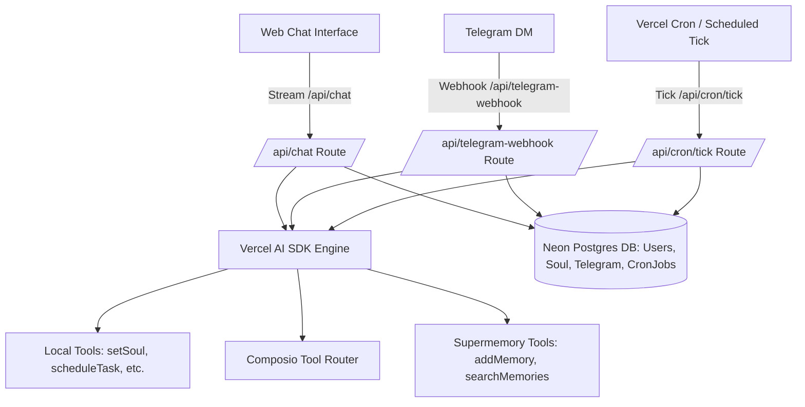

# Antigravity General-Purpose AI Agent 🚀

A production-ready, general-purpose autonomous AI agent built on Next.js App Router, powered by the Vercel AI SDK, Composio external tool integrations, Supermemory long-term memory, Telegram bot interface, and Vercel Cron scheduled automation.

## Features

- **Dynamic Tool Execution (Composio)**: Native integration with Composio's Tool Router session API, allowing the agent to dynamically discover and invoke external tools (Gmail, GitHub, Notion, Slack, etc.) scoped per-user.
- **Persistent Long-Term Memory (Supermemory)**: Scoped per-user containers storing durable facts, preferences, and user profile information across conversations and channels.
- **Conversational Onboarding & Agent Soul**: Automated discovery flow on first sign-in that tailors the agent's voice, tone, and principles into a persistent markdown "Soul" saved in Neon Postgres.
- **Unified Telegram Bot Interface**: Access the exact same agent, memory, and connected tools directly through Telegram via deep-linked account pairing and webhooks.
- **Automated Scheduled Tasks (Vercel Cron)**: Agent-managed recurring background tasks (e.g., daily briefings, reminders) triggered via Vercel Cron.
- **Graceful Degradation**: If optional API keys (Composio, Supermemory, Telegram) are missing or services are down, the application continues serving chats seamlessly without crashing.
- **Guest vs. Regular Mode**: Dedicated guest user mode with privacy safeguards preventing external OAuth credential exposure and long-term memory contamination.

---

## Architecture Overview



---

## Getting Started Locally

### 1. Prerequisites
- Node.js 20+
- pnpm 10+
- Google Antigravity CLI (`agy`)

### 2. Install Dependencies
```bash
pnpm install
```

### 3. Environment Variables
Copy `.env.local.example` to `.env.local` and populate your secrets:
```bash
cp .env.local.example .env.local
```

Key environment variables:
| Variable | Description |
|---|---|
| `AUTH_SECRET` | Secret string for session signing |
| `POSTGRES_URL` | Neon Postgres connection string |
| `OPENAI_API_KEY` / `AI_GATEWAY_API_KEY` | Model provider API key |
| `COMPOSIO_API_KEY` | Composio platform API key |
| `SUPERMEMORY_API_KEY` | Supermemory API key |
| `TELEGRAM_BOT_TOKEN` | Bot token from @BotFather |
| `TELEGRAM_BOT_USERNAME` | Bot username |
| `TELEGRAM_WEBHOOK_SECRET` | Secret token for incoming webhook verification |
| `CRON_SECRET` | Secret token for securing Vercel Cron ticks |
| `NEXT_PUBLIC_APP_URL` | Base application URL |

### 4. Database Migrations
Generate and run Drizzle migrations against your Neon Postgres database:
```bash
pnpm drizzle-kit generate
pnpm drizzle-kit migrate
```

### 5. Run the Development Server
```bash
pnpm dev
```
Open [http://localhost:3000](http://localhost:3000) in your browser.

---

## Deployment to Vercel

### Step 1: Push Code to GitHub
Ensure all code is committed and pushed to your remote repository:
```bash
git add .
git commit -m "feat: complete production-ready AI agent"
git push origin main
```

### Step 2: Import Project to Vercel
1. Open your [Vercel Dashboard](https://vercel.com/dashboard) and click **Add New... > Project**.
2. Select your repository (`tahadeab-ai/Agent`).
3. Set the Framework Preset to **Next.js**.

### Step 3: Add Environment Variables in Vercel
In the Vercel project configuration, add all variables defined in `.env.local.example`:
- `AUTH_SECRET`
- `POSTGRES_URL`
- `OPENAI_API_KEY` (or `AI_GATEWAY_API_KEY`)
- `COMPOSIO_API_KEY`
- `SUPERMEMORY_API_KEY`
- `TELEGRAM_BOT_TOKEN`
- `TELEGRAM_BOT_USERNAME`
- `TELEGRAM_WEBHOOK_SECRET`
- `CRON_SECRET`
- `NEXT_PUBLIC_APP_URL` (set to your Vercel deployment URL, e.g. `https://my-agent.vercel.app`)

### Step 4: Configure Telegram Webhook
Once the application is deployed on Vercel, register your production webhook using the included helper script:
```bash
./scripts/set-telegram-webhook.sh "<TELEGRAM_BOT_TOKEN>" "https://<your-project>.vercel.app" "<TELEGRAM_WEBHOOK_SECRET>"
```
Or via `curl`:
```bash
curl -X POST "https://api.telegram.org/bot<TELEGRAM_BOT_TOKEN>/setWebhook" \
  -H "Content-Type: application/json" \
  -d '{
    "url": "https://<your-project>.vercel.app/api/telegram-webhook",
    "secret_token": "<TELEGRAM_WEBHOOK_SECRET>"
  }'
```

### Step 5: Vercel Deployment Protection Note
If **Deployment Protection** (Vercel Authentication / SSO Protection) is enabled on your project:
- Incoming Telegram webhook requests (`/api/telegram-webhook`) and automated Vercel Cron ticks (`/api/cron/tick`) may receive `401 Unauthorized` responses if blocked by deployment protection.
- To resolve this, configure **Automation Bypass for Secret** or exclude the `/api/*` webhook paths from Vercel Deployment Protection in **Project Settings > Deployment Protection**.

---

## Admin & Control Pages

- **`/` (Chat)**: Interactive streaming chat with live tool execution feedback, onboarding detection, and sample prompts.
- **`/admin` (Integrations)**: Displays per-user connected accounts via Composio with UI indicators for guest mode and missing API keys.
- **`/admin/agent` (Soul Management)**: View, edit, and save your agent's custom markdown Soul, or reset back to default to trigger fresh conversational onboarding.
- **`/admin/telegram` (Telegram Linking)**: Generate secure 10-minute deep link tokens to pair your mobile Telegram account with your web profile.
- **`/admin/schedules` (Vercel Cron Tasks)**: View scheduled recurring tasks, inspect last execution outputs, delete jobs, or use "Run Now" to test trigger automated jobs immediately.
